# LLMGW by Vulpoint.com : gateway LLM avec anonymisation

[English version](README.md)

Version **1.2.0** · notes de version dans [RELEASE_NOTES.md](RELEASE_NOTES.md) · documentation intégrée sur `/docs/` (administration) et `/docs/chat.html` (guide utilisateur du chat), sources dans [docs/](docs/).

<p align="center"></p>

Un seul binaire Go, sans dépendance externe (SQLite et dashboard embarqués), pour Mac et Linux.

```
clients (API OpenAI / Anthropic)  →  llmgw  →  LLM cibles (OpenAI, Anthropic, Mistral, Ollama, vLLM…)
          clé gateway → utilisateur → profil → cibles autorisées (ordre = repli)
          anonymisation à l'aller, restauration au retour (streaming compris)
          métriques SQLite → /dashboard
```

## Démarrer

```bash
cp config.example.toml config.toml     # puis adapter cibles, profils, utilisateurs
export MISTRAL_API_KEY=… ANTHROPIC_API_KEY=… OPENAI_API_KEY=…
./llmgw -config config.toml -check     # valide la configuration
./llmgw -config config.toml            # http://127.0.0.1:8080/dashboard
./llmgw -version                       # affiche la version
```

### App macOS (barre des menus)

`macapp/build.sh` construit une **LLMGW.app autonome** dans `dist/`, ainsi que `dist/LLMGW-<version>.dmg` pour l'installer par glisser-déposer dans Applications (Go et les Command Line Tools d'Xcode servent à la construction, rien n'est nécessaire à l'exécution). La passerelle est embarquée dans l'app, en binaire universel (Apple Silicon et Intel) qui n'utilise que des bibliothèques fournies avec macOS. Les données sont dans `~/Library/Application Support/LLMGW` : au premier lancement, l'app y crée une configuration de départ avec un jeton d'administration aléatoire et un modèle `secrets.env` (droits 600). Le menu permet de modifier la configuration et les secrets, de copier le jeton d'administration et de choisir un autre dossier de données (par exemple une installation existante). Double-cliquer : une icône apparaît dans la barre des menus, avec une pastille d'état (verte en marche, orange au démarrage, rouge arrêtée) et un menu pour démarrer, arrêter ou redémarrer la passerelle, ouvrir le dashboard, le chat et la documentation, afficher le journal (`llmgw.log`) et ouvrir l'app à l'ouverture de session. L'app charge `secrets.env`, démarre la passerelle à son ouverture et l'arrête quand on la quitte. Menu en anglais, français ou néerlandais. Sans l'app, `start.command` lance la passerelle dans le Terminal en double-clic et ouvre le dashboard.

Construire : `go build -o llmgw .`. Pour Linux depuis le Mac : `GOOS=linux GOARCH=amd64 go build -o dist/llmgw-linux-amd64 .` (ou directement `deploy/deploy.sh`, voir plus bas).

Côté client, il suffit de changer l'URL et la clé :

| Client | Réglage |
|---|---|
| SDK OpenAI / outils compatibles | `base_url = http://gateway:8080/v1`, `api_key = <clé gateway>` |
| SDK Anthropic / Claude Code | `ANTHROPIC_BASE_URL=http://gateway:8080`, `ANTHROPIC_API_KEY=<clé gateway>` |

Modèle : `mistral-large` (routage automatique selon le profil) ou `mistral/mistral-large` (cible imposée).
`GET /v1/models` liste les modèles autorisés pour l'utilisateur, `GET /v1/me` son profil, ses quotas et sa consommation.

## Déployer sur un VPS

Un VPS Linux (Debian 12 ou Ubuntu 24.04, systemd) suffit : 1 vCPU et 1 à 2 Go de RAM. Le gateway voit passer les données en clair avant l'anonymisation : choisir un hébergeur UE sous droit UE (OVHcloud, Scaleway, Hetzner, Infomaniak…) et signer un contrat de sous-traitance (art. 28 RGPD). Le PaaS avec volume est possible ; le serverless ne convient pas (pas de disque persistant, ni de tâches de fond, ni de streaming long garanti).

Seul le binaire part sur le serveur, compilé depuis le Mac. Go n'est pas nécessaire côté serveur. `deploy/deploy.sh` fait tout en une commande :

```bash
deploy/deploy.sh --config config.toml --domain gateway.mondomaine.be --admin-ip 203.0.113.7 root@mon-vps
```

1. `go vet` et `go test`, puis compilation pour l'architecture du serveur (amd64 ou arm64, détectée).
2. Copie, puis sur le serveur : utilisateur système `llmgw`, dossier `/opt/llmgw` (700), service `deploy/llmgw.service` (systemd durci, `TZ=Europe/Brussels`).
3. Le nouveau binaire valide la configuration (`-check`) **avant** de remplacer l'ancien. S'il ne démarre pas, le script revient à la version précédente (`llmgw.prev`).
4. Avec `--domain`, Caddy est installé et configuré (`deploy/Caddyfile`) : HTTPS Let's Encrypt, streaming SSE sans tampon, clés retirées des journaux, `/dashboard` et `/admin` réservés aux IP `--admin-ip`. Sans `--admin-ip`, on y accède seulement par tunnel SSH : `ssh -L 8080:127.0.0.1:8080 mon-vps`, puis `http://127.0.0.1:8080/dashboard`.

**Premier déploiement.** `--config` est obligatoire. Le script crée `/opt/llmgw/secrets.env` vide (root, 600) : y mettre les clés (`MISTRAL_API_KEY=…`, une par ligne), puis `systemctl restart llmgw`. Les fichiers `words_file` relatifs doivent être copiés à côté de `config.toml`. Avant d'ouvrir le serveur : un `admin_token` long et aléatoire (vide = administration ouverte ; le script prévient), `listen = "127.0.0.1:8080"`, un pare-feu limité à 22, 80 et 443 (`ufw allow OpenSSH && ufw allow 80,443/tcp && ufw enable`) et SSH par clé seulement. Le DNS du domaine doit pointer vers le VPS pour que Let's Encrypt délivre le certificat.

**Mises à jour.** `deploy/deploy.sh root@mon-vps` (sans `--config`) remplace le binaire et garde la configuration du serveur, modifiée depuis le dashboard. Avec `--config`, l'ancienne est gardée en `config.toml.bak-deploy-*`. Un compte non root avec `sudo` fonctionne aussi.

**Sauvegardes.** Sauvegarder `config.toml` et la base : `sqlite3 /opt/llmgw/gateway.db ".backup /chemin/gateway-$(date +%F).db"`, et non une simple copie du fichier pendant que le service tourne. Ne pas placer la base dans un dossier synchronisé (Dropbox…) ou réseau : SQLite en mode WAL s'y corrompt.

**Exploitation.** `systemctl status llmgw`, `journalctl -u llmgw -f`. Si le paquet `caddy` manque (Ubuntu 22.04), l'installer depuis le dépôt officiel de Caddy, puis relancer le script.

**Windows.** Le binaire compile (`GOOS=windows`), mais trois limites restent : chemins absolus de `words_file` mal gérés, pas de service Windows natif (passer par NSSM ou WinSW) et droits `0600` sans effet. Linux reste la cible recommandée.

## Authentification SSO (Entra ID, Google)

Le portail `/chat` et le dashboard acceptent une connexion **Microsoft Entra ID**, **Google** ou tout fournisseur **OpenID Connect**, en plus des clés gateway (toujours utilisées par l'API) et de `admin_token`. Section `[auth]` de `config.toml` (exemple commenté dans `config.example.toml`).

- **Profil** : un `[users.x]` avec `email = …` garde son profil et ses quotas ; sinon la première règle `mappings` qui correspond (groupe Entra, rôle d'application, motif d'email) ; sinon `default_profile` ; sinon refus.
- **Administration** : comptes `[[admins]]` avec le rôle Admin (tout) ou Support (utilisateurs, statistiques, Debug sur autorisation), ainsi que les règles `admin_roles`, `admin_groups` ou `admin_emails` des fournisseurs. Ils accèdent au dashboard sans jeton.
- **Sécurité** : code d'autorisation avec PKCE, `state` et `nonce` ; signature RS256 du jeton d'identité vérifiée sur les clés publiées par le fournisseur ; cookie de session signé, `HttpOnly`, `SameSite=Lax`, `Secure` en HTTPS ; les appels de l'interface exigent en plus l'en-tête `X-LLMGW-Session`, ce qui bloque les requêtes intersites.
- La correspondance groupes → profil est évaluée à la connexion : un changement de groupe s'applique à la session suivante (`session_hours`, 12 h par défaut).

**Entra ID** : Portail Azure → Entra ID → Inscriptions d'applications → Nouvelle inscription, type « Web », adresse de retour `https://<passerelle>/auth/callback/entra`. Noter l'ID de tenant et l'ID client, créer un secret client (`ENTRA_CLIENT_SECRET`). Pour les profils par groupe : « Configuration du jeton » → ajouter la revendication de groupes (de préférence « Groupes affectés à l'application », pour rester sous la limite de 200 groupes du jeton). Pour l'administration : déclarer un rôle d'application (par exemple `LLMGW.Admin`) et l'affecter dans « Applications d'entreprise ».

**Google** : Google Cloud Console → API et services → Identifiants → ID client OAuth, type « Application Web », URI de redirection `https://<passerelle>/auth/callback/google`. Écran de consentement « Interne » pour un Google Workspace. Google ne transmet pas les groupes : les profils s'attribuent par domaine (`allowed_domains`, `default_profile`), par email (`mappings`) ou par utilisateur déclaré.

Au démarrage, le journal rappelle l'adresse de retour de chaque fournisseur. La page Alertes et SSO du dashboard les affiche aussi.

## Fonctionnement

**Routage.** La clé identifie l'utilisateur, l'utilisateur a un profil, le profil liste les cibles autorisées dans l'ordre de préférence. La première cible qui accepte le format d'API et le modèle est utilisée. En cas d'erreur réseau, 5xx ou 429, la suivante prend le relais.

**Anonymisation.** Les détecteurs (`[[detectors]]`) repèrent emails, téléphones, IBAN, NISS, cartes, IP, noms précédés d'un titre, listes de noms ou d'entreprises et motifs personnalisés (numéros de dossier, identifiants…). Selon le profil, chaque type est :
- `anonymize` : remplacé par `«TYPE_n»`, puis restauré dans la réponse ;
- `block` : requête refusée (403) et comptée comme violation ;
- `log` : laissé passer, mais compté ;
- `off` : ignoré.

Détecteurs intégrés supplémentaires : adresses (`address`), localités belges et lieux de résidence (`place`), animaux (`pet`), prénoms seuls FR/NL/EN (`firstname_alone`), hôpitaux et réseaux de soins belges (`be_health_orgs`), identifiants après un mot de contexte (`ref_context`), dates de naissance (`birthdate`) ou toutes les dates (`date`). Termes jamais anonymisés : liste intégrée (produits, sigles techniques) et `[privacy] allow`.

Un nom repéré une fois (« Mme Claire Dubois ») est aussi remplacé ailleurs dans la conversation (« Dubois »). La numérotation est stable pour une requête donnée, donc le cache de prompt des fournisseurs reste efficace.

**Images et fichiers.** Par profil : `images` vaut `pass` (non changée), `blank` (remplacée par un carré blanc avant le LLM) ou `block` (refusée et journalisée) ; `files` donne une action par extension : `pass_log` (transmis et journalisé), `blank` (carré blanc), `block` (refusé et journalisé) ou `block_alert` (refusé, alerte email et journal) ; `files_default` s'applique aux extensions non listées. Le journal des fichiers (date, utilisateur, profil, LLM, nom du fichier, extension, taille, SHA-256, action) est conservé 30 jours, même sans mode Debug ; le contenu n'est jamais stocké.

**Restauration.** Les jetons sont remplacés dans la réponse, y compris en streaming SSE : un jeton coupé entre deux morceaux est retenu jusqu'à être complet. Les blocs `thinking` signés ne sont pas modifiés.

**Métriques.** Chaque requête enregistre utilisateur, cible, modèle, statut, octets, tokens et temps IN (lecture client), GATEWAY (traitement), LLM (cible) et premier octet, avec les compteurs de détection par type. **Aucune valeur sensible n'est stockée.** Après `raw_retention_days` (30 j), le détail est agrégé par jour × utilisateur × cible. Le modèle et les percentiles sont alors perdus, et les agrégats sont conservés environ 6 mois (`agg_retention_days = 200`). Le dashboard propose 48 h, 60 j, 6 semaines et 6 mois (profondeur maximale).

**Quotas.** Par profil (pour chaque utilisateur), surchargeables par utilisateur, et par LLM cible (budget partagé) : requêtes/minute, requêtes/jour, tokens/jour, tokens/mois. Si un quota est dépassé, la requête est bloquée (429) ou simplement journalisée (alerte). Une cible saturée est sautée au profit de la suivante du profil.

**Dashboard (`/dashboard`).** Pages regroupées : Pilotage (Vue d'ensemble, Reporting), Accès (Utilisateurs, Profils), Modèles (LLM cibles avec voyant de connexion, Quotas), Données (Filtrage et privacy : détecteurs, règles par profil, fichiers par extension, exceptions, banc de test ; Journal des fichiers ; Debug), Paramètres (Alertes et SSO, Comptes d'administration, Journal d'audit). Les modifications sont validées puis écrites dans `config.toml` (10 dernières versions gardées en `.bak-*`, enregistrement refusé si le fichier a changé entre-temps) et appliquées à chaud. Les clés ne sont jamais renvoyées au navigateur. Bouton Documentation et version en bas du menu.

**Chat (`/chat`).** Fenêtre de chat pour les utilisateurs : connexion SSO ou par clé gateway, choix du modèle autorisé, pièces jointes (txt, md, csv, json, PDF, docx : texte extrait dans le navigateur, puis anonymisé par le gateway ; images selon le profil), historique des 10 dernières conversations dans le navigateur. Sous chaque échange, le nombre de données pseudonymisées et le LLM qui a répondu. Bouton « ? Aide » vers le guide utilisateur. L'extraction PDF/docx charge pdf.js et mammoth depuis cdnjs.

**Prompt de comportement et alertes.** Chaque profil peut porter un `system_prompt`, ajouté en tête de toutes ses requêtes (après l'anonymisation, donc non modifié), et des `alert_emails`. Section `[alerts]` : serveur SMTP (587 STARTTLS ou 465 TLS), destinataires par défaut, déclencheurs (violation, quota, erreur LLM) et fréquence du récapitulatif. Les fichiers en `block_alert` sont toujours signalés. Les emails ne contiennent aucune valeur sensible. Bouton « Envoyer un test » dans le dashboard.

**Comptes d'administration et audit.** Rôles Admin et Support vérifiés côté serveur. Le journal d'audit trace les connexions, les enregistrements de configuration (liste des changements, sans secret), les consultations et purges Debug, les tests d'alerte ; conservé 400 jours.

**Langues de l'interface.** Le dashboard et le chat s'affichent en anglais (par défaut), français ou néerlandais, au choix dans chaque interface. Les données ne sont jamais traduites.

**Mode DEBUG (onglet Debug).** Désactivé par défaut. Une fois activé, chaque échange est archivé : la requête telle que reçue par le LLM (anonymisée), la réponse brute du LLM avant restauration, les correspondances jeton → valeur d'origine et chaque mot détecté avec l'action appliquée. La vue détaillée bascule entre « vue anonymisée » (jetons en gras) et « vue d'origine » (valeurs en gras, en bleu si anonymisées, en rouge si bloquées, en orange si journalisées). Les valeurs sont stockées **en clair** : purge automatique après `retention_hours` (24 h par défaut), bandeau « DEBUG actif » dans le dashboard, bouton pour vider l'archive.

**Configuration.** `config.toml` est rechargé à chaud : une configuration invalide est refusée et l'ancienne reste active.

## Limites actuelles

- Noms et entreprises : détectés s'ils figurent dans une liste ou suivent un titre (M., Mme, Dr…). Sans liste, il faudrait un modèle NER (Presidio, spaCy…) branché en service.
- Logos et texte dans les images : pas d'analyse d'image. On choisit par profil de laisser passer, remplacer par un carré blanc ou bloquer. Un modèle sans prise en charge des images peut refuser une requête qui contient le carré blanc.
- Le LLM doit recopier les jetons `«…»`. La consigne `placeholder_hint` le lui demande. Un jeton reformulé par le modèle (traduit, sans guillemets) n'est pas restauré.
- Pas de traduction entre formats : un client OpenAI n'est routé que vers des cibles `api = "openai"`, et un client Anthropic que vers des cibles `api = "anthropic"`.

## Fichiers

| Fichier | Rôle |
|---|---|
| `main.go` | serveur, routes, rechargement à chaud, version |
| `proxy.go` | authentification, routage, repli, relais normal et SSE |
| `anon.go` | détecteurs, anonymisation, restauration, images et fichiers |
| `names.go`, `context.go`, `places.go` | heuristiques de noms, de contexte et de lieux |
| `config.go` | chargement et validation de la configuration |
| `auth.go` | SSO OpenID Connect (Entra ID, Google, OIDC), sessions |
| `audit.go` | comptes d'administration, rôles, journal d'audit |
| `admin.go` | API d'admin : configuration, consommation, test des cibles |
| `filelog.go` | journal des fichiers (30 jours) |
| `debug.go` | archive DEBUG |
| `quota.go` | compteurs de consommation et quotas |
| `alerts.go` | alertes email |
| `store.go` | SQLite, agrégation, statistiques |
| `dashboard.html`, `chat.html`, `i18n.js` | dashboard, chat et traductions EN/FR/NL (embarqués) |
| `docs/` | documentation intégrée : administration, guide utilisateur du chat, captures |
| `RELEASE_NOTES.md` | notes de version |
| `gateway_test.go` | tests de bout en bout avec faux LLM : `go test ./...` |
| `macapp/LLMGW.swift`, `macapp/build.sh` | app macOS autonome de la barre des menus (passerelle embarquée) et son script de construction (app + DMG) |
| `start.command` | démarrage en double-clic dans le Terminal (macOS) |
| `deploy/deploy.sh` | compilation, copie et redémarrage sur un VPS (`--help`) |
| `deploy/remote-install.sh` | partie serveur de `deploy.sh` : validation, installation, retour arrière |
| `deploy/llmgw.service` | service systemd durci |
| `deploy/Caddyfile` | HTTPS, streaming SSE et accès admin restreint |
