# LLMGW by Vulpoint.com: LLM gateway with anonymisation

[Version française](README.fr.md)

Version **1.4.0** · release notes in [RELEASE_NOTES.md](RELEASE_NOTES.md) (French) · built-in documentation at `/docs/` (administration) and `/docs/chat.html` (chat user guide), sources in [docs/](docs/) (French).

<p align="center"></p>

A single Go binary with no external dependency (SQLite, dashboard, chat and documentation are embedded), for macOS and Linux.

```
clients (OpenAI / Anthropic API)  →  llmgw  →  target LLMs (OpenAI, Anthropic, Mistral, DeepSeek, Ollama, vLLM…)
          gateway key → user → profile → allowed targets (order = fallback)
          anonymisation on the way out, restoration on the way back (streaming included)
          SQLite metrics → /dashboard
```

## Getting started

```bash
cp config.example.toml config.toml     # then adapt targets, profiles and users
export MISTRAL_API_KEY=… ANTHROPIC_API_KEY=… OPENAI_API_KEY=…
./llmgw -config config.toml -check     # validates the configuration
./llmgw -config config.toml            # http://127.0.0.1:8080/dashboard
./llmgw -version                       # prints the version
```

### macOS app (menu bar)

`macapp/build.sh` builds a **self-contained LLMGW.app** in `dist/` (`macapp/build.sh --install` also installs it in Applications), plus `dist/LLMGW-<version>.dmg` to install it by drag and drop into Applications (Go and the Xcode Command Line Tools are needed to build, nothing to run). The gateway is embedded in the app as a universal binary (Apple Silicon and Intel) that only uses libraries shipped with macOS. The data lives in `~/Library/Application Support/LLMGW`: on first launch the app creates a starting configuration with a random admin token and a `secrets.env` template (both 600). The menu edits the configuration and the secrets, copies the admin token, and can point to another data folder (for example an existing installation). Double-click it: an icon appears in the menu bar with a status dot (green running, orange starting, red stopped) and a menu to start, stop or restart the gateway, open the dashboard, the chat and the documentation, show the log (`llmgw.log`) and open the app at login. The app loads `secrets.env`, starts the gateway when it opens and stops it when it quits. Menu in English, French or Dutch. Without the app, `start.command` starts the gateway in Terminal with a double-click and opens the dashboard.

Build with `go build -o llmgw .`; `./build.sh` produces the macOS app and the Linux archives (see Building below).

On the client side, only the URL and the key change:

| Client | Setting |
|---|---|
| OpenAI SDK / compatible tools | `base_url = http://gateway:8080/v1`, `api_key = <gateway key>` |
| Anthropic SDK / Claude Code | `ANTHROPIC_BASE_URL=http://gateway:8080`, `ANTHROPIC_AUTH_TOKEN=<gateway key>` |

Model: `mistral-large` (routed automatically according to the profile) or `mistral/mistral-large` (forced target).
`GET /v1/models` lists the models allowed for the user, and `GET /v1/me` returns their profile, quotas and usage. `GET /version` returns the version.

## Building

```bash
./build.sh                            # tests, then macOS app + DMG and Linux archives in dist/
./build.sh --linux-only --skip-tests  # Linux archives only
./build.sh --mac-only                 # LLMGW.app and DMG only
```

`dist/` then holds `LLMGW.app` and `LLMGW-<version>.dmg` (Apple Silicon and Intel), `llmgw-<version>-linux-amd64.tar.gz` and `-arm64.tar.gz` (static binary, `setup.sh`, systemd unit, Caddyfile, `LISEZMOI.txt`), and `SHA256SUMS`.

## Deploying on a VPS

A Linux VPS (Ubuntu 22.04 / 24.04 or Debian 12, systemd) is enough: 1 vCPU and 1 to 2 GB of RAM (2 vCPU for heavy agent traffic, see Performance below). The gateway sees the data in clear text before anonymisation, so choose an EU host under EU law (OVHcloud, Scaleway, Hetzner, Infomaniak…) and sign a data processing agreement (GDPR art. 28). Serverless does not fit: no persistent disk, no background tasks, no guaranteed long streaming.

**On a fresh server**, `setup.sh` (inside the Linux archive) installs or updates everything; it can be run again safely:

```bash
scp dist/llmgw-<version>-linux-amd64.tar.gz admin@my-vps:
ssh admin@my-vps
tar xzf llmgw-<version>-linux-amd64.tar.gz && cd llmgw-<version>
sudo ./setup.sh --domain gateway.example.com --email it@example.com --admin-ip 203.0.113.7
```

- System packages, automatic security updates, fail2ban for SSH, ufw firewall (SSH first, then 80 and 443).
- `llmgw` system user, `/opt/llmgw` (700), hardened systemd unit, `secrets.env` (600) for the provider keys.
- First install: `config.toml` generated with a random admin token (shown once, kept in `/opt/llmgw/admin_token.txt`), random example user keys, listening on localhost, trusted proxies and admin addresses in `[security]`.
- With `--domain`: Caddy and its Let's Encrypt certificate; the dashboard is only reachable from the `--admin-ip` addresses (otherwise through an SSH tunnel: `ssh -L 8080:127.0.0.1:8080 my-vps`).
- The new binary validates the configuration before replacing the old one; if it does not start, the previous version is restored.
- Daily backup of the database and configuration in `/var/backups/llmgw` (14 days).

**From the Mac**, `deploy/deploy.sh` does it in one command (build, copy, `setup.sh`):

```bash
deploy/deploy.sh --domain gateway.example.com --email it@example.com --admin-ip 203.0.113.7 admin@my-vps
deploy/deploy.sh admin@my-vps        # update: configuration, database and Caddy kept
```

Then put the provider keys in `/opt/llmgw/secrets.env` (`MISTRAL_API_KEY=…`) and run `systemctl restart llmgw`. `setup.sh` does not touch SSH: disable password login yourself once your key is in place. `setup.sh` was tested in a simulated environment only: try it on a disposable VPS first.

**Backups.** Use `sqlite3 gateway.db ".backup …"`, never a plain file copy while the service runs. Do not keep the database in a synchronised folder (Dropbox…) or on a network share: SQLite in WAL mode gets corrupted there.

**Windows.** The binary compiles (`GOOS=windows`), but absolute `words_file` paths are handled poorly, there is no native Windows service (use NSSM or WinSW) and `0600` permissions have no effect. Linux remains the recommended target.

## SSO authentication (Entra ID, Google)

The `/chat` portal and the dashboard accept sign-in with **Microsoft Entra ID**, **Google** or any **OpenID Connect** provider. Gateway keys (always used by the API) and `admin_token` keep working alongside SSO. SSO is configured in the `[auth]` section of `config.toml`; a commented example is in `config.example.toml`.

- **Profile**: a `[users.x]` entry with `email = …` keeps its profile and quotas. Otherwise the first matching `mappings` rule applies (Entra group, app role, email pattern), then `default_profile`. Without any of these, sign-in is refused.
- **Administration**: `[[admins]]` accounts with the Admin (everything) or Support (users, statistics, Debug when granted) role. The providers' `admin_roles`, `admin_groups` and `admin_emails` rules also apply.
- **Security**:
  - authorisation code flow with PKCE, `state` and `nonce`;
  - RS256 signature of the ID token checked against the keys published by the provider;
  - signed session cookie: `HttpOnly`, `SameSite=Lax`, and `Secure` over HTTPS;
  - interface calls must also carry the `X-LLMGW-Session` header, which blocks cross-site requests.
- Group-to-profile mapping is evaluated at sign-in, so a group change applies from the next session (`session_hours`, 12 h by default).

**Entra ID**
1. In the Azure portal, go to Entra ID → App registrations → New registration. Choose the « Web » type and set the redirect URI to `https://<gateway>/auth/callback/entra`.
2. Note the tenant ID and the client ID, and create a client secret (`ENTRA_CLIENT_SECRET`).
3. For profiles per group: in « Token configuration », add the groups claim. Prefer « Groups assigned to the application », to stay under the token's 200-group limit.
4. For administration: declare an app role (for example `LLMGW.Admin`) and assign it in « Enterprise applications ».

**Google**
1. In the Google Cloud Console, go to APIs & Services → Credentials → OAuth client ID. Choose the « Web application » type and set the redirect URI to `https://<gateway>/auth/callback/google`.
2. Use an « Internal » consent screen for a Google Workspace.

Google does not send groups, so profiles are assigned by domain (`allowed_domains`, `default_profile`), by email (`mappings`) or by declared user.

At startup, the log shows the redirect URI of each provider. The Alerts and SSO page of the dashboard shows them too.

## How it works

**Routing.** The key identifies the user, the user has a profile, and the profile lists the allowed targets in order of preference. The gateway uses the first target that accepts the API format and the model. On a network error, a 5xx or a 429, the next one takes over. Model aliases per target (`claude-*` → `deepseek-flash`) and a `json_schema` → `json_object` downgrade are available for providers that need them.

**Anonymisation.** Detectors (`[[detectors]]`) find:
- emails, phone numbers, IBANs, Belgian national numbers (NISS), INAMI / RIZIV numbers of healthcare providers (check key verified), cards and IP addresses;
- names (title, known first name in FR/NL/EN, lists) and companies;
- addresses, Belgian places and pets;
- Belgian healthcare organisations;
- identifiers after a context word (« file », « patient », « n° »…);
- dates of birth, or all dates;
- custom regular expressions and term lists.

Depending on the profile, each data type is:
- `anonymize`: replaced by `«TYPE_n»`, then restored in the answer;
- `block`: request refused (403) and counted as a violation;
- `log`: let through, but counted;
- `off`: ignored.

A name found once (« Mrs Claire Dubois ») is also replaced elsewhere in the conversation (« Dubois »). A name memory of HMAC fingerprints recognises it later, typos included, without storing any name in clear text. Terms that are never anonymised come from a built-in list (products, technical acronyms) and from `[privacy] allow`. Numbering is stable for a given request, so the providers' prompt cache stays effective.

**Images and files.** Each profile sets:
- `images`: `pass` (unchanged), `blank` (replaced by a white square before reaching the LLM) or `block` (refused and logged);
- `files`, per extension: `pass_log` (sent unchanged and logged), `blank` (white square), `block` (refused and logged) or `block_alert` (refused, email alert and log);
- `files_default`: the action for extensions that are not listed.

The file log records the date, user, profile, LLM, file name, extension, size, SHA-256 and action. It is kept 30 days, even without Debug mode, and never stores the content.

**Restoration.** Tokens are replaced in the answer, including in SSE streaming: a token split between two chunks is held until it is complete. Signed `thinking` blocks are left untouched.

**Metrics.** Each request records the user, target, model, status, bytes, tokens and timings, along with detection counters per type. The timings are IN (reading the client), GATEWAY (processing), LLM (target) and first byte. **No sensitive value is stored.**

After `raw_retention_days` (30 days), the detail is aggregated per day × user × target. The model and the percentiles are then lost, and the aggregates are kept for about 6 months (`agg_retention_days = 200`). The dashboard offers 48 h, 60 days, 6 weeks and 6 months (maximum depth).

**Quotas.** Quotas can be set per profile (for each user), overridden per user, and per target LLM (shared budget): requests per minute, requests per day, tokens per day and tokens per month. When a quota is exceeded, the request is blocked (429) or only logged (alert). A saturated target is skipped in favour of the profile's next one.

**Dashboard (`/dashboard`).** The pages are grouped as follows:
- **Monitoring**: Overview, Reporting.
- **Access**: Users, Profiles.
- **Models**: Target LLMs (with a connection light), Quotas.
- **Data**: Filtering and privacy (detectors, rules per profile, files per extension, exceptions, test bench), File log, Debug.
- **Settings**: Alerts and SSO, Administration accounts, Audit log.

Changes are validated, then written to `config.toml` and applied without a restart. The last 10 versions are kept as `.bak-*`, and a save is refused if the file changed in the meantime. Provider keys are never sent to the browser. A Documentation button and the version appear at the bottom of the menu.

**Chat (`/chat`).** A chat window for users:
- sign-in with SSO or a gateway key, and choice of an allowed model;
- attachments: txt, md, csv, json, PDF, docx and images. The text is extracted in the browser, then anonymised by the gateway; images follow the profile;
- history of the last 10 conversations, kept in the browser;
- under each exchange, the number of pseudonymised values and the LLM that answered;
- a « ? Help » button that opens the user guide.

PDF and docx extraction loads pdf.js and mammoth from cdnjs.

**Behaviour prompt and alerts.** Each profile can carry:
- a `system_prompt`, added at the top of all its requests after anonymisation, so it is never modified;
- `alert_emails`.

The `[alerts]` section sets the SMTP server (587 STARTTLS or 465 TLS), the default recipients, the triggers (violation, quota, LLM error) and the summary frequency. Files set to `block_alert` are always reported. Emails contain no sensitive value.

**Administration accounts and audit.** Admin and Support roles are enforced on the server side. The audit log records sign-ins, configuration saves (with the list of changes, without secrets), Debug views and purges, and alert tests. It is kept 400 days.

**DEBUG mode (Debug page).** Off by default. When enabled, every exchange is archived:
- the request as received by the LLM (anonymised);
- the raw LLM answer, before restoration;
- the token → original value mapping;
- every detected word, with the action applied.

The detail view switches between the anonymised view and the original view, with values highlighted by action. Values are stored **in clear text**, so the archive is protected in three ways: automatic purge after `retention_hours` (24 h by default), a « DEBUG on » banner in the dashboard, and a button to empty the archive.

**Interface languages.** The dashboard and the chat are available in English (default), French and Dutch, through a selector in each interface. Data (names, descriptions, prompts, answers) is never translated.

**Configuration.** `config.toml` is reloaded without a restart. An invalid configuration is refused and the previous one stays active.

**Web protection (`[security]`, Web security page).** For a gateway exposed to the Internet; on by default. Per-address limits (600 requests/min, 32 concurrent; IPv6 per /64), temporary ban after 10 refused sign-ins in 10 min (bad key or admin token, forged cookie, invented link: 30 min, doubled at each repeat, 24 h at most; audited and emailed), admin address allow list, real client address behind trusted proxies (`X-Forwarded-For` from a direct client is ignored), security headers (CSP, HSTS in HTTPS…), optional built-in HTTPS (`tls_cert`, `tls_key`), anonymisation work capped at twice the number of cores. Local calls (Mac app, SSH tunnel) are never limited. Web sessions: role recomputed at every request, sign-out revokes the session, « Close all sessions » button. A stored key is kept only for the address it was entered for.

**Access requests (`[access]`, Access requests page).** « Request access » on the chat sign-in screen: name, email, reason. The person confirms their address through a single-use link sent by email (a page with a button, because mail filters open links). Trusted domain: access granted at once with the default profile, the gateway key shown once. Other domain: waits for a decision in the dashboard (Admin or Support), refused after 14 days without one; approval emails a single-use link to the key. The key is never sent by email. Requires the SMTP server of `[alerts]` and the public `[auth] base_url`.

## Performance

Measured on an Apple M5 (10 cores), native arm64 build, with a corpus of French medical prose containing one personal-data sentence per KB. Anonymisation is the only CPU-heavy step: the gateway adds well under a millisecond for routing, then the anonymisation time below; the LLM's own latency (seconds) dominates.

| Measure (anonymisation, standard profile) | 1.3.0 | 1.4.0 |
|---|---|---|
| 1 KB of text | 1.9 ms | 0.36 ms |
| 10 KB | 21 ms | 4.4 ms |
| 100 KB, one request (detectors in parallel) | 250 ms | 15 ms |
| 100 KB history resent by an agent, next turn (cache) | 200 ms | 4 ms |
| 110 KB with 2,000 names in the name memory | 1.8 s | 50 ms |

| End-to-end throughput, new text at every request (worst case) | 10 cores | 2 cores |
|---|---|---|
| 2 KB requests | ~5,200 req/s (1.3.0: ~1,100) | ~1,700 req/s |
| 50 KB requests | ~190 req/s (1.3.0: ~38) | ~67 req/s |
| 50 KB requests whose text was already seen (agent history) | ~1,700 req/s | ~620 req/s |

An entry-level VPS core is slower than an M5 core: count on half these figures. Even then, 2 vCPU absorb several MB of new text per second, far more than the LLM providers deliver; the gateway is not the bottleneck. The cache between requests uses up to ~64 MB of RAM.

## Current limitations

- Names and companies are detected when they appear in a list, follow a title (Mr, Mrs, Dr…) or a known first name, or were seen before. A name with none of these clues, the first time, would need an NER model (Presidio, spaCy…) plugged in as a service.
- There is no image analysis (logos, text in images). The profile chooses to let images through, replace them with a white square or block them.
- A name learned at one turn is also replaced in the earlier messages, which therefore change at the next turn. Names in a form without a recognised label (« Nom : Vandamme »), first names that are also common words (Max, Jan, Hugo) and decomposed Unicode (NFD) may escape detection.
- The LLM must copy the `«…»` tokens back. The `placeholder_hint` instruction asks it to. A token the model rewrites (translated, without quotes) is not restored.
- A model without image support may reject a request that contains the white square.
- There is no translation between formats: an OpenAI client is only routed to `api = "openai"` targets, and an Anthropic client only to `api = "anthropic"` targets.

## Files

| File | Role |
|---|---|
| `main.go` | server, routes, hot reload, version |
| `proxy.go` | authentication, routing, fallback, plain and SSE relay |
| `anon.go` | detectors, anonymisation, restoration, images and files |
| `names.go`, `context.go`, `places.go` | name, context and place heuristics |
| `config.go` | configuration loading and validation |
| `auth.go` | OpenID Connect SSO (Entra ID, Google, OIDC), sessions |
| `audit.go` | administration accounts, roles, audit log |
| `admin.go` | admin API: configuration, usage, target tests |
| `filelog.go` | file log (30 days) |
| `debug.go` | DEBUG archive |
| `quota.go` | usage counters and quotas |
| `alerts.go` | email alerts |
| `store.go` | SQLite, aggregation, statistics |
| `dashboard.html`, `chat.html`, `i18n.js` | dashboard, chat and EN/FR/NL translations (embedded) |
| `docs/` | built-in documentation (French): administration, chat user guide, screenshots |
| `RELEASE_NOTES.md` | release notes (French) |
| `gateway_test.go` | end-to-end tests with fake LLMs: `go test ./...` |
| `anon_test.go` | anonymisation regression tests and benchmarks (`go test -bench Anon`) |
| `macapp/LLMGW.swift`, `macapp/build.sh` | self-contained macOS menu bar app (embedded gateway) and its build script (app + DMG) |
| `start.command` | double-click start in Terminal (macOS) |
| `shield.go` | web protection: client address, limits, bans, security headers |
| `access.go` | access requests: confirmation links, approval, key retrieval |
| `build.sh` | macOS app + DMG and Linux archives in `dist/` |
| `deploy/setup.sh`, `deploy/LISEZMOI.txt` | installer for a fresh Ubuntu / Debian server (inside the Linux archive) |
| `deploy/deploy.sh` | build, copy and `setup.sh` on a VPS in one command (`--help`) |
| `deploy/llmgw.service` | hardened systemd unit |
| `deploy/Caddyfile` | HTTPS, SSE streaming and restricted admin access |
